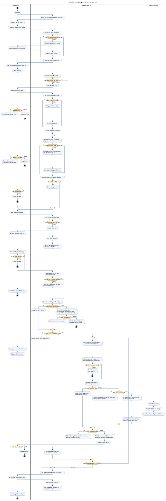
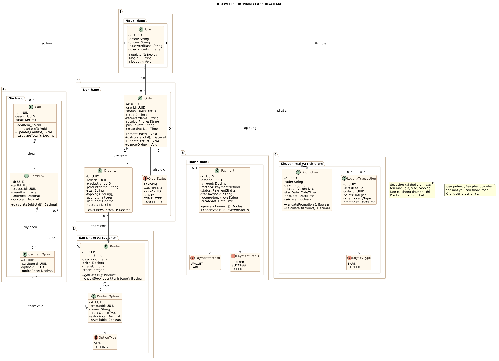
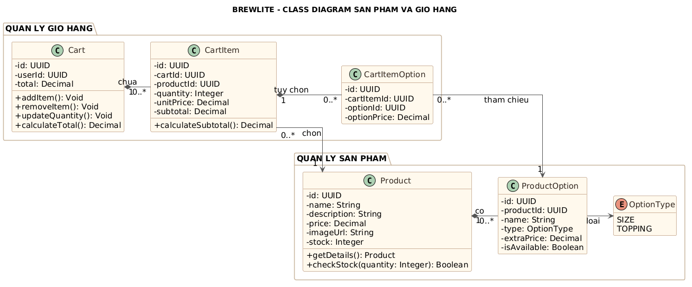
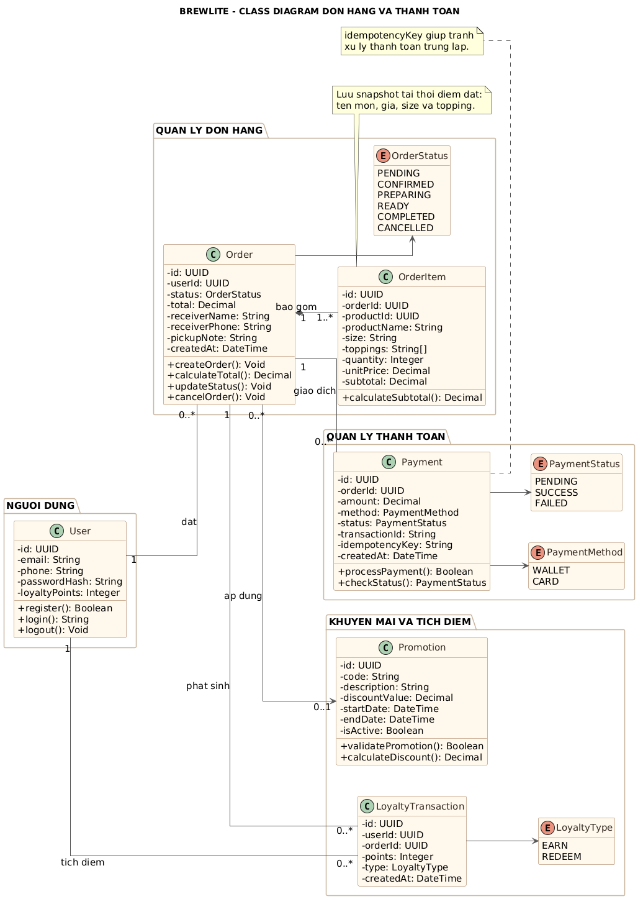
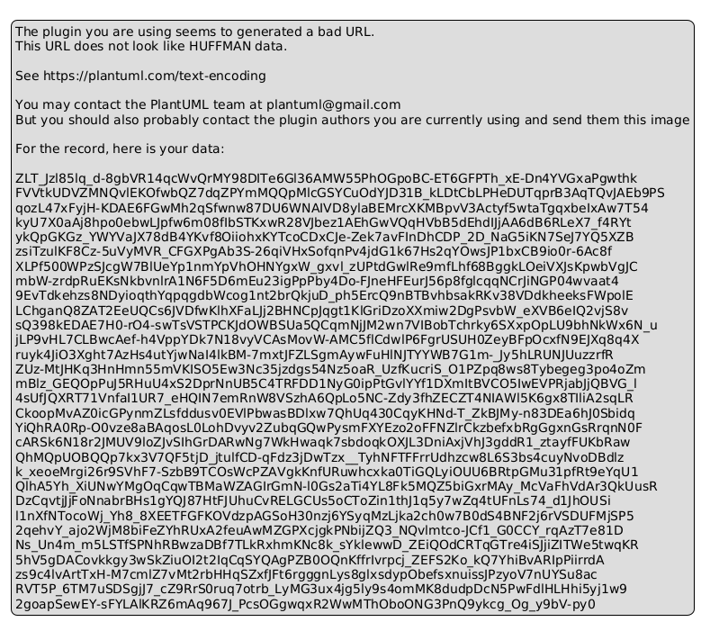

# 📐 Mô hình hóa Hệ thống (System Modeling) – Task 2

Tài liệu này tổng hợp 3 sơ đồ UML cốt lõi của hệ thống **BrewLite** theo quy định tại **Task 2** (Assignment 2):
1. **Task 2.1:** Sơ đồ Hoạt động (Activity Diagram) – Toàn bộ luồng nghiệp vụ end-to-end.
2. **Task 2.2:** Sơ đồ Tuần tự (Sequence Diagram) – Use-case trọng tâm Đặt và thanh toán đơn hàng (UC-01).
3. **Task 2.3:** Sơ đồ Lớp Lĩnh vực (Domain Class Diagram) – Mô hình thực thể và cấu trúc dữ liệu hệ thống.

---

## 1. Task 2.1 – Activity Diagram (Sơ đồ Hoạt động)

Sơ đồ mô tả chi tiết toàn bộ luồng nghiệp vụ từ khi khách hàng duyệt menu đến khi hoàn tất đơn hàng và theo dõi tiến độ pha chế.

### 📌 Điểm nổi bật trong thiết kế:
- **Phân làn trách nhiệm (Swimlanes):**
  - **Khách hàng (Customer):** Thực hiện duyệt món, chọn tùy chọn, quản lý giỏ hàng, xác nhận thông tin và thanh toán.
  - **Hệ thống BrewLite (Next.js & NestJS):** Kiểm tra phiên đăng nhập (JWT), kiểm tra tồn kho, snapshot dữ liệu đơn hàng, kiểm soát Idempotency Key, cập nhật trạng thái đơn.
  - **Dịch vụ thanh toán (Payment Gateway):** Tiếp nhận yêu cầu thanh toán mô phỏng sandbox và phản hồi kết quả (Thành công / Thất bại).
- **Xử lý đầy đủ các nhánh rẽ nghiệp vụ & ngoại lệ:**
  - *Chưa đăng nhập:* Bắt buộc đăng nhập trước khi tiếp tục đặt hàng; cho phép thử lại hoặc dừng luồng.
  - *Hết hàng / Thay đổi giá:* Cảnh báo kịp thời khi tồn kho không đủ hoặc giá món có sự cập nhật.
  - *Chống tạo đơn trùng lặp:* Tận dụng Idempotency Key để truy hồi đơn hàng đã tạo, tránh trừ tồn kho hai lần.
  - *Thanh toán thất bại:* Cho phép khách hàng chọn phương thức khác (Ví/Thẻ) hoặc thử lại với Idempotency Key mới mà không làm mất giỏ hàng.

---

## 2. Task 2.2 – Sequence Diagram (Sơ đồ Tuần tự)

Sơ đồ thể hiện sự tương tác tuần tự qua các Lifeline cho use-case trọng tâm **UC-01: Đặt và thanh toán đơn hàng**.

- **File mã nguồn PlantUML:** [`sequence-checkout.puml`](sequence-checkout.puml)
- **File ảnh kết xuất Vector:** [`sequence-checkout.svg`](sequence-checkout.svg)

### 📌 Các Lifeline tham gia:
1. `Customer (Khách hàng)`
2. `Next.js UI (Frontend)`
3. `NestJS API (Backend)`
4. `PostgreSQL (Database)`
5. `Mock Payment Service (SePay Sandbox)`

### 📌 Các điểm nhấn kỹ thuật quan trọng:
1. **Kiểm tra JWT & Idempotency khi đặt hàng:** Xác thực token người dùng trước khi cấp quyền; kiểm tra `idempotencyKey` để chống double-click.
2. **Database Transaction ($transaction) & Concurrency Control:**
   - Sử dụng cơ chế khóa bi quan: `SELECT stock FROM Product WHERE id = item.productId FOR UPDATE`.
   - Kiểm tra tồn kho từng sản phẩm; nếu thiếu, thực hiện `ROLLBACK` ngay lập tức và trả mã lỗi `400 Bad Request`.
   - Nếu đủ, trừ tồn kho và tạo đơn hàng với trạng thái `PENDING`.
3. **Xử lý Thanh toán & Double-Click Lock:**
   - Bản ghi `PaymentTransaction` được khởi tạo với trạng thái `PROCESSING` kèm Unique Constraint trên khóa giao dịch.
   - Nếu client gửi lặp lại yêu cầu đang xử lý, hệ thống trả về `409 Conflict` hoặc chờ kết quả thay vì gọi cổng thanh toán lần 2.
   - Nhánh `SUCCESS`: Cập nhật trạng thái đơn thành `PAID` và lưu mã giao dịch.
   - Nhánh `FAILED`: Cập nhật đơn thành `PAYMENT_FAILED`, giữ nguyên số lượng kho tạm thời cho phép thử lại hoặc giải phóng khi hết hạn timeout.

---

## 3. Task 2.3 – Class Diagram (Sơ đồ Lớp Lĩnh vực)

Sơ đồ lớp mô tả cấu trúc các đối tượng nghiệp vụ, thuộc tính, kiểu dữ liệu, phương thức và mối quan hệ (multiplicity) trong hệ thống BrewLite.

### 3.1 Sơ đồ lớp tổng quát (Overall Domain Class Diagram)

Hệ thống được tổ chức thành 6 nhóm chức năng (Packages):
1. **Người dùng (User):** Lưu thông tin tài khoản, mật khẩu băm (bcrypt) và điểm tích lũy.
2. **Sản phẩm & Tùy chọn (Product & ProductOption):** Quản lý đồ uống, giá bán, tồn kho, kích cỡ (size) và topping.
3. **Giỏ hàng (Cart, CartItem, CartItemOption):** Quản lý giỏ hàng tạm thời và các tùy chọn món đã chọn của khách hàng.
4. **Đơn hàng (Order, OrderItem):** Quản lý đơn hàng, thông tin giao nhận, trạng thái xử lý đơn.
   > **Lưu ý nghiệp vụ:** Lớp `OrderItem` áp dụng cơ chế **Data Snapshotting** để lưu cố định tên món, giá bán, size và topping tại thời điểm đặt đơn. Khi giá sản phẩm gốc thay đổi, dữ liệu đơn hàng lịch sử hoàn toàn không bị ảnh hưởng.
5. **Thanh toán (Payment):** Quản lý giao dịch thanh toán mô phỏng, phương thức, trạng thái và khóa `idempotencyKey`.
6. **Khuyến mãi & Tích điểm (Promotion, LoyaltyTransaction):** Phục vụ mở rộng tích điểm thành viên và mã giảm giá.

### 3.2 Chi tiết Sản phẩm & Giỏ hàng

### 3.3 Chi tiết Đơn hàng & Thanh toán

---

## 4. Bảng Định nghĩa Quan hệ & Kiểu Liệt kê (Enums)

### Bảng quan hệ (Multiplicity):
| Cặp quan hệ | Bội số (Multiplicity) | Ý nghĩa nghiệp vụ |
|---|:---:|---|
| **User – Cart** | `1` – `0..1` | Mỗi người dùng có tối đa một giỏ hàng đang kích hoạt |
| **User – Order** | `1` – `0..*` | Một người dùng có thể đặt nhiều đơn hàng trong lịch sử |
| **Product – ProductOption** | `1` – `0..*` | Một sản phẩm có thể có nhiều tùy chọn size / topping |
| **Cart – CartItem** | `1` – `0..*` | Giỏ hàng chứa nhiều mục sản phẩm được chọn |
| **Order – OrderItem** | `1` – `1..*` | Đơn hàng hợp lệ bắt buộc phải có ít nhất 01 món |
| **Order – Payment** | `1` – `0..*` | Một đơn hàng có thể có nhiều lần thử thanh toán |
| **Order – Promotion** | `0..*` – `0..1`| Một đơn hàng áp dụng tối đa một mã khuyến mãi |
| **User – LoyaltyTransaction** | `1` – `0..*` | Một người dùng có lịch sử nhiều lần tích / tiêu điểm |

### Danh sách các Enum trạng thái:
- **`OrderStatus`:** `PENDING`, `CONFIRMED`, `PREPARING`, `READY`, `COMPLETED`, `CANCELLED`.
- **`PaymentStatus`:** `PENDING`, `SUCCESS`, `FAILED`.
- **`PaymentMethod`:** `WALLET`, `CARD`.
- **`OptionType`:** `SIZE`, `TOPPING`.
- **`LoyaltyType`:** `EARN`, `REDEEM`.

---

## 5. Task 3.2 ? Deployment Diagram (S? ?? Tri?n khai Production)

S? ?? m? t? c?u tr?c v?t l?, h? t?ng cloud, m?ng k?t n?i v? ranh gi?i m?i tr??ng cho h? th?ng BrewLite tr?n m?i tr??ng v?n h?nh th?c t?.

- **File m? ngu?n PlantUML:** [`deployment-diagram.puml`](deployment-diagram.puml)
- **File ?nh k?t xu?t:** [`deployment-diagram.png`](deployment-diagram.png)
- **T?i li?u ??c t? chi ti?t:** [`docs/deployment.md`](../deployment.md)

### ?? ?i?m nh?n k? thu?t:
1. **Frontend Hosting:** Vercel Global Edge Network ph?c v? Next.js 14 PWA qua HTTPS / TLS 1.3 (port 443).
2. **Backend API:** Render.com PaaS ch?y Linux Container (Node.js 20 LTS, NestJS 10) t?i c?ng n?i b? 3001, reverse proxy ra c?ng 443.
3. **Database:** Render Managed PostgreSQL 16 g?n ??a l?u tr? b?n v?ng (Persistent Storage Disk) k?t n?i n?i b? c?ng 5432 b?o m?t qua SSL.
4. **C?ng thanh to?n:** SePay Sandbox Gateway k?t n?i hai chi?u qua HTTPS API v? Webhook IPN (`POST /payments/ipn`).
5. **CI/CD:** GitHub Actions t? ??ng ki?m th? (Lint, Type-check, Jest) v? trigger t? ??ng tri?n khai khi push v?o nh?nh `main`.
