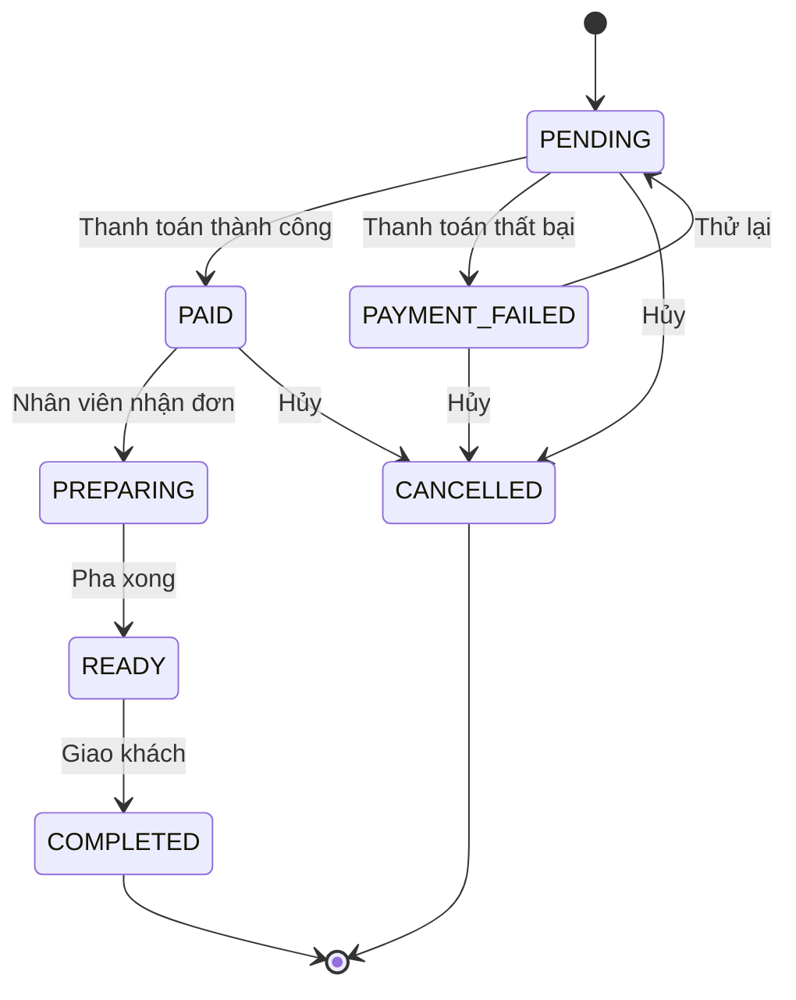

# Order State Machine: quy tắc và bằng chứng kiểm thử

Triển khai phần kiểm soát chuyển trạng thái của FR-12 theo sơ đồ được yêu cầu. Quy tắc nằm trong `apps/api/src/orders/order-state-machine.ts`, hàm `assertTransition(from, to)`.

## Các chuyển tiếp được phép



| Trạng thái hiện tại | Trạng thái tiếp theo hợp lệ |
|---|---|
| `PENDING` | `PAID`, `PAYMENT_FAILED`, `CANCELLED` |
| `PAYMENT_FAILED` | `PENDING`, `CANCELLED` |
| `PAID` | `PREPARING`, `CANCELLED` |
| `PREPARING` | `READY` |
| `READY` | `COMPLETED` |
| `COMPLETED` | Không có; trạng thái kết thúc |
| `CANCELLED` | Không có; trạng thái kết thúc |

Mọi cặp khác, bao gồm chuyển về chính trạng thái hiện tại qua API cập nhật trạng thái, đều bị chặn. `PAYMENT_FAILED` được bổ sung bằng migration `20261113010000_order_state_machine`; dữ liệu đơn hàng hiện có được giữ nguyên.

## API và tính nguyên tử

`PATCH /orders/:id/status` nhận `{ "status": "READY" }`:

Endpoint yêu cầu `Authorization: Bearer <accessToken>` của tài khoản `BARISTA` hoặc `ADMIN`. Endpoint `PATCH /staff/orders/:id/status` dùng cùng logic cập nhật; xem [API nhân viên](./staff-api.md).

- **200:** chuyển tiếp hợp lệ, trả bản ghi đơn đã cập nhật.
- **400:** thiếu trạng thái hoặc giá trị không thuộc enum.
- **401/403:** thiếu/token không hợp lệ hoặc không có quyền nhân viên.
- **404:** không tìm thấy đơn.
- **409:** cặp chuyển tiếp không hợp lệ; bản ghi đơn, kể cả `updatedAt`, giữ nguyên.

Mỗi thao tác khóa dòng đơn bằng `SELECT ... FOR UPDATE` trong Prisma interactive transaction rồi mới kiểm tra trạng thái. API cập nhật trạng thái, checkout và IPN cùng khóa dòng đơn trước khi ghi, vì vậy yêu cầu đến sau kiểm tra trạng thái đã commit của yêu cầu trước.

Thanh toán dùng cùng hàm chuyển trạng thái:

- IPN `SUCCESS`: `PENDING -> PAID`, cập nhật Payment và Order trong cùng transaction.
- IPN `FAILED`: `PENDING -> PAYMENT_FAILED`, cập nhật cả hai bản ghi trong cùng transaction.
- Checkout lại đơn `PAYMENT_FAILED`: chuyển về `PENDING` và đặt Payment về `PENDING`. Lần thử mới dùng **idempotency key mới**; gửi lại key cũ trả kết quả của lần cũ.
- IPN trùng hoàn toàn (`status`, `transactionRef`, `amount`) trả kết quả đã lưu, không ghi lại đơn hoặc thanh toán. Đây là phát lại kết quả, không phải chuyển tiếp về chính trạng thái hiện tại.
- IPN đến sau khi đơn đã hủy không mở lại đơn. IPN trùng sau khi pha chế/hoàn tất không kéo đơn về `PAID`. Callback thất bại không ghi đè giao dịch đã thành công.
- Nếu ghi Payment thất bại, cập nhật Order được rollback. Mã giao dịch đã dùng cho payment khác trả **409**.

Phân quyền nhân viên đã được áp dụng cho hai API cập nhật trạng thái bằng JWT và `RolesGuard` (`BARISTA`/`ADMIN`). Tích hợp SePay hiện vẫn mô phỏng; xác thực chữ ký webhook và đối soát số tiền cần được triển khai riêng.

## Bằng chứng unit/integration test

| Nhóm | File | Điều được chứng minh |
|---|---|---|
| `UT-SM-01` | `apps/api/src/orders/order-state-machine.spec.ts` | Cho phép đúng 9 cạnh trong sơ đồ |
| `UT-SM-02` | Cùng file trên | Chặn 40 cặp còn lại trong ma trận 7 × 7, gồm nhảy bước, đi ngược, trạng thái kết thúc và tự chuyển |
| `UT-SM-03` | Cùng file trên | Từ chối 8 dạng trạng thái không hợp lệ |
| `UT-ORD-04..07` | `apps/api/src/orders/orders.service.spec.ts` | Chạy trong transaction; chuyển sai không gọi ghi DB; dữ liệu sai/mã đơn thiếu bị từ chối |
| `UT-PAY-03..10` | `apps/api/src/payments/payments.service.spec.ts` | IPN, thử lại và checkout tuân thủ quy tắc; replay không làm lùi trạng thái |
| `INT-SM-01` | `apps/api/test/order-state-machine.e2e-spec.ts` | Gọi HTTP thật, 9 chuyển hợp lệ được lưu vào PostgreSQL |
| `INT-SM-02` | Cùng file trên | 40 chuyển sai trả 409; truy vấn lại DB xác nhận toàn bộ bản ghi giữ nguyên |
| `INT-SM-03..04` | Cùng file trên | 400/404 đúng hợp đồng, không làm đổi đơn |
| `INT-SM-05..06` | Cùng file trên | Luồng hoàn tất và nhánh thất bại/thử lại chạy xuyên API + DB |
| `INT-SM-07..09` | Cùng file trên | Chặn IPN mở lại đơn, replay không làm lùi trạng thái, chặn checkout sai trạng thái |
| `INT-SM-10` | Cùng file trên | Ràng buộc unique của Payment thất bại khiến cập nhật Order rollback |
| `INT-SM-11..12` | Cùng file trên | Hai cập nhật trái nhau không cùng thành công; Order/Payment vẫn nhất quán khi IPN đến đồng thời |

Kiểm thử integration tạo schema ngẫu nhiên riêng cho mỗi suite, tự xóa sau test. Không dọn bảng dữ liệu ứng dụng.

Chạy từ thư mục gốc (PowerShell):

```powershell
# Cập nhật database local và Prisma Client
node --env-file=.env apps/api/node_modules/prisma/build/index.js migrate deploy --schema apps/api/prisma/schema.prisma
npm.cmd --prefix apps/api run prisma:generate

# Chạy riêng bằng chứng state machine
npm.cmd --prefix apps/api test -- --runInBand order-state-machine
npm.cmd --prefix apps/api run test:e2e -- order-state-machine

# Chạy toàn bộ backend
npm.cmd --prefix apps/api run build
npm.cmd --prefix apps/api test -- --runInBand
npm.cmd --prefix apps/api run test:e2e
```

Kết quả kiểm tra ngày 2026-11-13: **98 unit test** và **81 integration test** của toàn bộ backend pass. Riêng ma trận state machine có **57 unit test** và file integration state machine có **68 test**.
